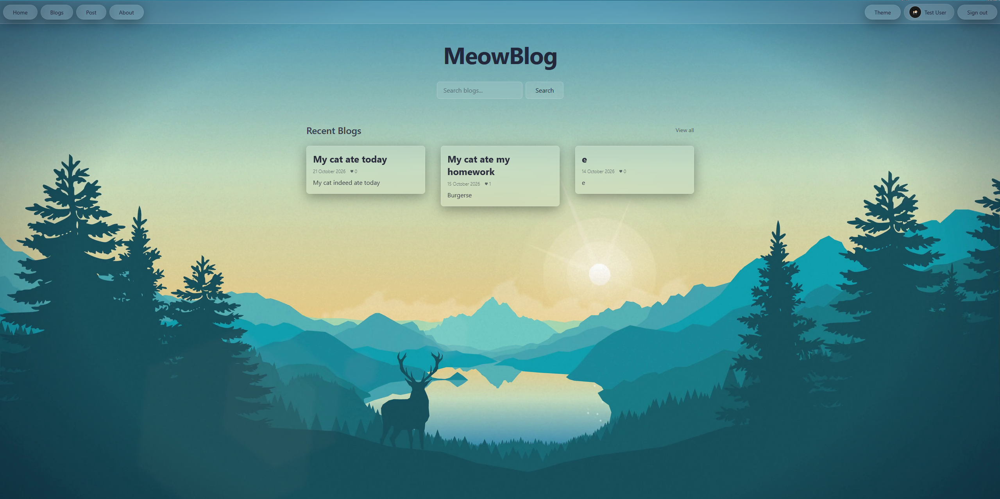

# MeowBlog

It's a Blog site!

And it can do stuff!

## How to use:
Go to [this site](https://meow-blog-steel.vercel.app/) and have fun.
Alternatively, run it locally by cloning this repository and doing the standard npm stuff

## Signing in (IMPORTANT):
To get full access to the site, please sign in with:
- **Email: test@example.com**
- **Password: password123**

## Features (yes those exist):
- Post blogs
- Edit blogs
- Delete blogs
- Like blogs
- Sign in and sign up (with betterAuth)
- Change profile picture (click the profile picture in the top right)
- Change the theme

## Screenshot:

## Why I chose this project:
I was always interested in how full stack web development actually worked since it's very different to just a static site.
It was quite difficult at first but it slowly got better :3

## Yeah uh thanks for reading :D